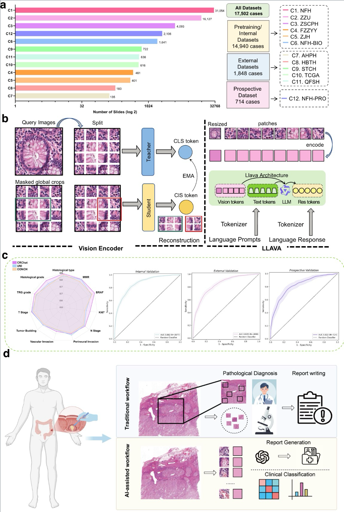
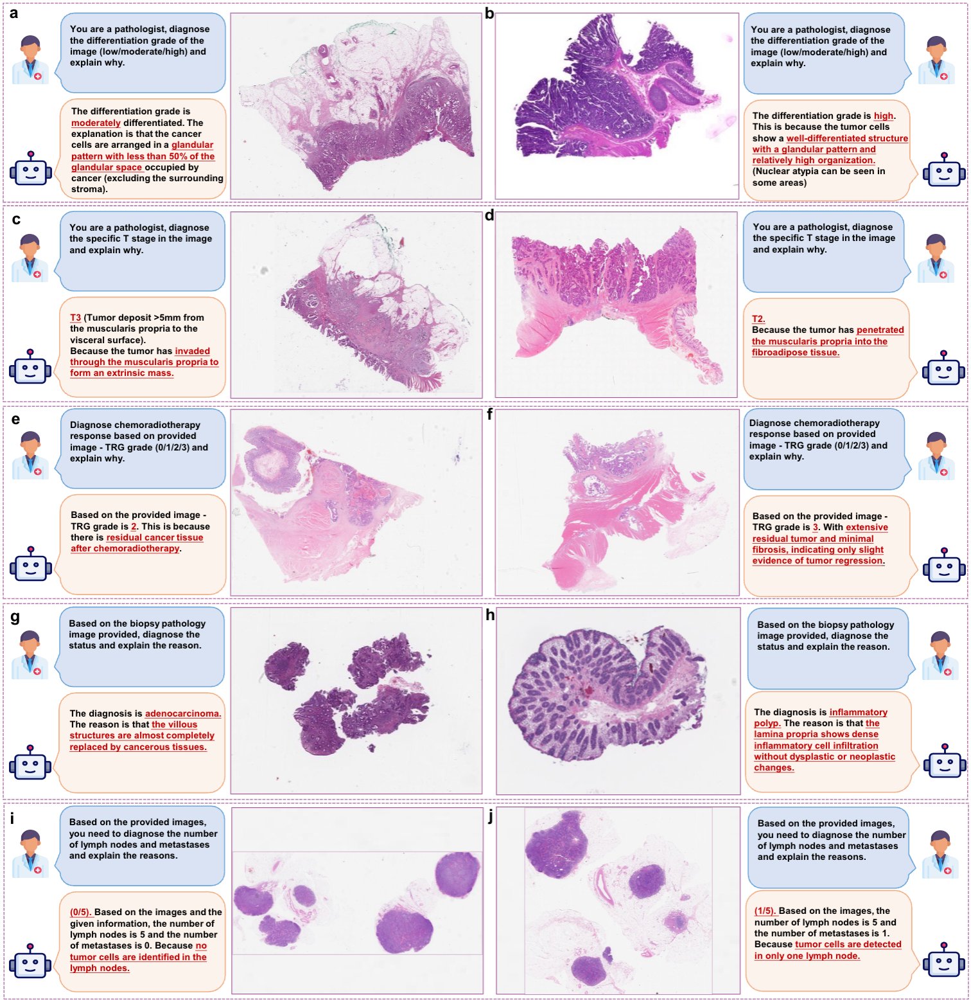
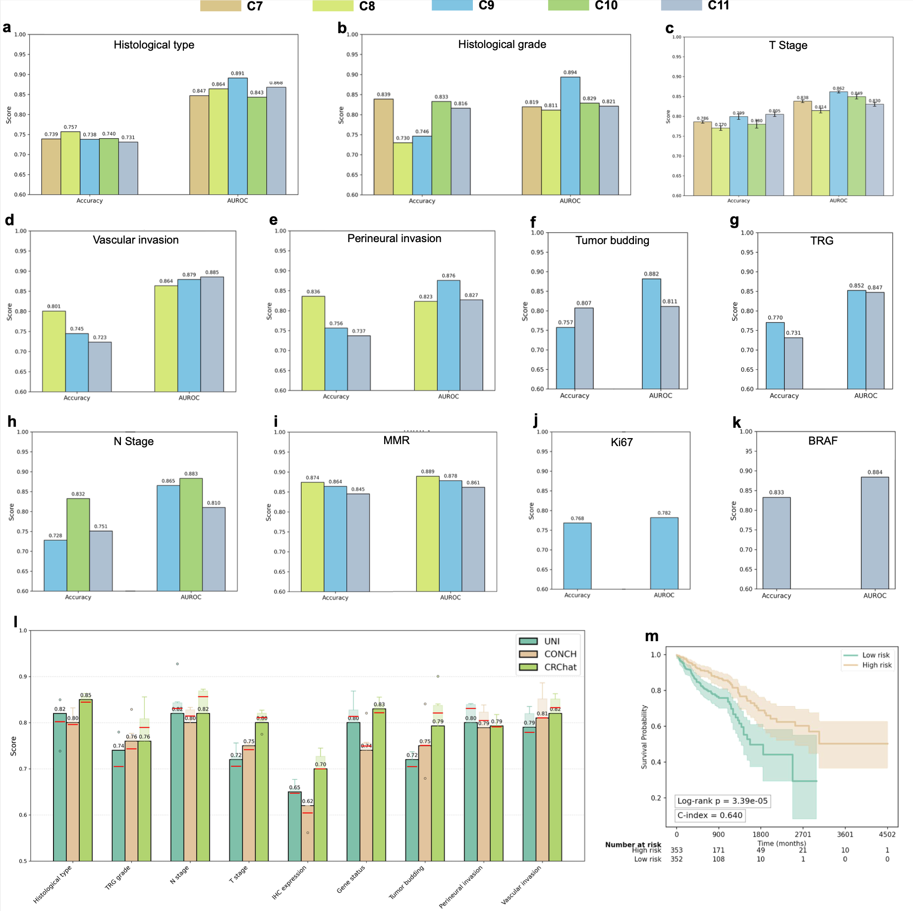

# CRChat

CRChat is a visual-language large model for colorectal cancer pathology, developed based on the open-source LLaVA framework. This project leverages image and text data to enable intelligent analysis and understanding in colorectal cancer scenarios.

## Overview


## Project Structure

This repository is based on [LLaVA](https://github.com/haotian-liu/LLaVA), with specific adaptations for colorectal cancer pathological images. It supports vision-language alignment, multi-turn Q&A, and can be applied to pathological diagnosis assistance as well as medical knowledge reasoning.

- `playground/`: Place and organize your training data here (`./playground/data`)
- `scripts/`: Contains scripts for data preprocessing, model training, and inference

## Demo


## Usage

### Pretraining

To pretrain the model on your dataset, run:
```
./scripts/train.sh
```
### Fine-tuning

After pretraining, perform task-specific fine-tuning with:
```
./scripts/train_tuning.sh
```
### Inference

To perform inference or interactive testing on new samples, run:
```
./scripts/infer.sh
```

### Results

